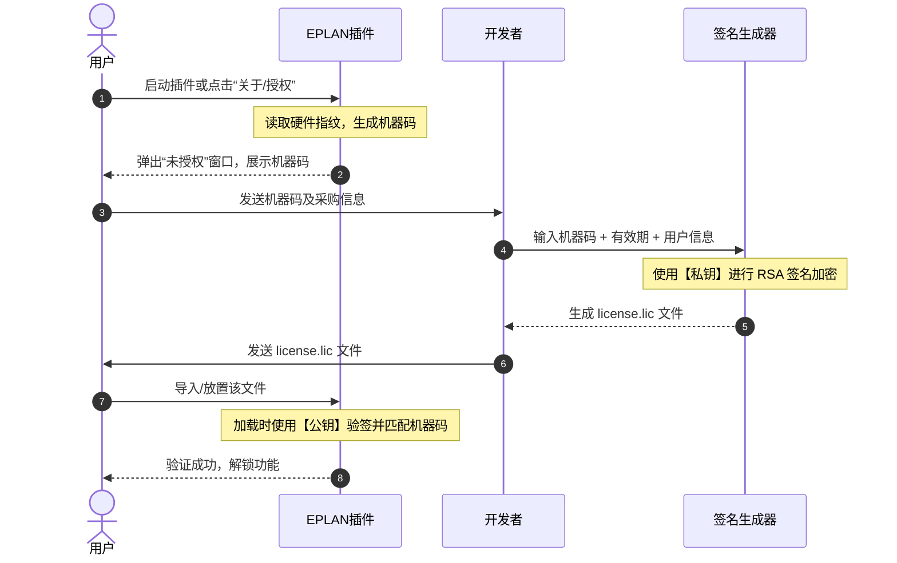

# EPLAN 插件授权系统可行性实施方案

本方案设计了一套适用于 EPLAN C# Add-in 插件的**离线一机一码（Node-locked）授权系统**。该系统基于 RSA-2048 非对称加密算法、硬件指纹收集技术和 .NET 代码加固技术，确保即使 DLL 被反编译，授权机制也极难被破解或伪造。

---

## 1. 方案核心要素与设计原理

### 1.1 安全基础：非对称加密 (RSA-2048)
* **私钥 (Private Key)**：由开发人员妥善保存在本地，**绝对不可打包进 DLL**。用于给客户的授权信息签名。
* **公钥 (Public Key)**：硬编码直接写在插件 DLL 源码中。用于在客户电脑上验证授权许可证的合法性。
* **安全性保证**：即使破解者通过反编译获取了公钥，因为缺少私钥，他们依然无法计算出合法的签名，从而无法伪造 `.lic` 授权文件。

### 1.2 物理绑定：机器码指纹 (Hardware ID)
通过读取不易更改的物理硬件序列号（CPU 序列号、主板 UUID）拼接并进行 SHA-256 哈希，生成客户电脑的唯一“机器码”，确保授权无法被复制到其他电脑使用。

### 1.3 核心流程时序图



---

## 2. 详细实施步骤与技术路线

### 第一步：生成 RSA-2048 密钥对
在开发环境中使用 .NET 提供的 `RSACryptoServiceProvider` 一次性生成密钥对：
* **私钥**（保存为 `PrivateKey.xml`，用于授权工具）。
* **公钥**（保存为 `PublicKey.xml`，硬编码在插件 `LicenseVerifier.cs` 中）。

### 第二步：插件端集成授权验证服务
在项目中新建 `License` 文件夹，添加如下三个核心类：

#### 1. 硬件指纹提取类 (`HardwareFingerprint.cs`)
收集 CPU ID、主板 ID 并进行哈希：
```csharp
using System;
using System.Management;
using System.Security.Cryptography;
using System.Text;

namespace TranslationEplAddIn.Tool.License
{
    public static class HardwareFingerprint
    {
        public static string GetMachineCode()
        {
            try
            {
                string cpuId = GetWmiProperty("Win32_Processor", "ProcessorId");
                string boardId = GetWmiProperty("Win32_BaseBoard", "SerialNumber");
                string raw = $"EPL-TRANS|{cpuId}|{boardId}";
                
                using (SHA256 sha = SHA256.Create())
                {
                    byte[] hashBytes = sha.ComputeHash(Encoding.UTF8.GetBytes(raw));
                    StringBuilder sb = new StringBuilder();
                    for (int i = 0; i < 8; i++) // 截取前 16 位字符已足够作为机器码
                    {
                        sb.Append(hashBytes[i].ToString("X2"));
                    }
                    return sb.ToString();
                }
            }
            catch
            {
                return "ERR-GET-HARDWARE-ID";
            }
        }

        private static string GetWmiProperty(string wmiClass, string property)
        {
            try
            {
                using (var searcher = new ManagementObjectSearcher($"SELECT {property} FROM {wmiClass}"))
                using (var collection = searcher.Get())
                {
                    foreach (var obj in collection)
                    {
                        return obj[property]?.ToString()?.Trim() ?? "";
                    }
                }
            }
            catch { }
            return "UNKNOWN";
        }
    }
}
```

#### 2. 授权验证核心类 (`LicenseVerifier.cs`)
公钥验签、机器码比对、到期时间校验：
```csharp
using System;
using System.IO;
using System.Security.Cryptography;
using System.Text;
using System.Web.Script.Serialization;

namespace TranslationEplAddIn.Tool.License
{
    public static class LicenseVerifier
    {
        // 替换为你生成出来的 XML 格式公钥（注意这只是公钥，即使被反编译也安全）
        private const string PublicKeyXml = @"<RSAKeyValue><Modulus>xxxxxx...</Modulus><Exponent>AQAB</Exponent></RSAKeyValue>";

        public static bool CheckLicense(string licensePath, out string errorMessage)
        {
            errorMessage = string.Empty;
            if (!File.Exists(licensePath))
            {
                errorMessage = "未找到授权文件(license.lic)。";
                return false;
            }

            try
            {
                string content = File.ReadAllText(licensePath).Trim();
                string[] parts = content.Split('.');
                if (parts.Length != 2)
                {
                    errorMessage = "许可证格式不正确。";
                    return false;
                }

                string rawJsonBytes = parts[0];
                string signatureBase64 = parts[1];
                string jsonData = Encoding.UTF8.GetString(Convert.FromBase64String(rawJsonBytes));
                byte[] signature = Convert.FromBase64String(signatureBase64);

                // 1. 验证签名
                using (var rsa = new RSACryptoServiceProvider())
                {
                    rsa.FromXmlString(PublicKeyXml);
                    byte[] dataBytes = Encoding.UTF8.GetBytes(rawJsonBytes);
                    bool isValid = rsa.VerifyData(dataBytes, CryptoConfig.MapNameToOID("SHA256"), signature);
                    if (!isValid)
                    {
                        errorMessage = "授权文件无效或已被非法修改！";
                        return false;
                    }
                }

                // 2. 校验内容
                var serializer = new JavaScriptSerializer();
                var lic = serializer.Deserialize<LicenseInfo>(jsonData);

                // 3. 校验机器码
                string localCode = HardwareFingerprint.GetMachineCode();
                if (lic.MachineCode != localCode)
                {
                    errorMessage = "此授权文件不适用于当前电脑。";
                    return false;
                }

                // 4. 校验到期时间
                DateTime expire = DateTime.ParseExact(lic.ExpireDate, "yyyy-MM-dd", null);
                if (DateTime.Now.Date > expire)
                {
                    errorMessage = $"授权已过期，到期时间为：{lic.ExpireDate}";
                    return false;
                }

                return true;
            }
            catch (Exception ex)
            {
                errorMessage = $"授权文件解析失败: {ex.Message}";
                return false;
            }
        }
    }

    public class LicenseInfo
    {
        public string MachineCode { get; set; }
        public string UserName { get; set; }
        public string ExpireDate { get; set; }
    }
}
```

### 第三步：EPLAN 入口集成与拦截
在插件的 `TranslationAddIn.cs`（实现 `IEplAddIn` 接口）中的 `OnInit()`，或在主窗口 `MainWindow.xaml.cs` 初始化时，先执行授权检查。

例如，在主窗口显示时拦截：
```csharp
protected override void OnSourceInitialized(EventArgs e)
{
    base.OnSourceInitialized(e);
    
    string licPath = Path.Combine(AppDomain.CurrentDomain.BaseDirectory, "license.lic");
    if (!LicenseVerifier.CheckLicense(licPath, out string error))
    {
        // 弹出授权激活窗口
        var registerWin = new RegisterWindow(error);
        if (registerWin.ShowDialog() != true)
        {
            this.Close(); // 拒绝授权，退出插件 UI
        }
    }
}
```

### 第四步：编写 WPF 激活界面 (`RegisterWindow.xaml`)
创建一个简易的授权界面：
* 展示当前电脑的 **“机器码”**（提供一键复制按钮）。
* 提供一个拖放许可证或选择本地许可证文件的路径文本框。
* 点击“激活”后，将文件复制到插件根目录，再次调用 `VerifyLicense`。如果通过，则 `DialogResult = true` 顺利加载主程序。

---

## 3. 防破解加固（必须配合发布）

> [!WARNING]
> .NET 程序如果没有经过强签名和混淆，破解者使用 dnSpy 修改你的 IL 代码只需要 10 秒钟。必须执行以下两项步骤：

### 3.1 启用强签名 (Strong Name Signing)
强命名不仅能够防御篡改，也是加载进 EPLAN 的官方推荐规范：
1. 右键 VS 项目属性 -> **签名**。
2. 勾选 **为程序集签名**。
3. 选择或新建一个强的 `.snk` 密码文件。
4. 强命名编译后的 DLL，如果被脱壳破解者尝试改动 IL 字节并重新保存，其强签名证书会因没有对应私钥而损坏，从而导致加载失败。

### 3.2 使用 ConfuserEx 进行代码混淆
使用 ConfuserEx（开源免费）或商业级 **.NET Reactor**：
1. 混淆所有类和方法名，将 `LicenseVerifier`、`CheckLicense`、`GetMachineCode` 等显眼的方法混淆成无意义字符（如 `a`, `b`, `c`）。
2. 启用 **“字符串加密 (String Encryption)”**，防止破解者全局搜索 `license.lic`、`机器码不一致` 等明文字符串定位到你的授权核验行。
3. 启用 **“控制流混淆 (Control Flow Obfuscation)”**，使得 dnSpy 逻辑树错乱，无法通过简单的反汇编进行反编译。

---

## 4. 可行性评估与开发周期

| 模块名称 | 实现功能 | 预计工期 | 风险点 & 应对措施 |
| :--- | :--- | :--- | :--- |
| **密钥对生成** | 制作密钥对，提取硬件码模块 | 0.5 天 | 部分精简版 Windows 系统无法通过 WMI 获取主板序列号。**应对策略**：加入网卡 MAC 物理地址作为备用读取方案。 |
| **插件验证集成** | 插件内加入公钥核验及运行环境异常截获 | 0.5 天 | 软件本地时间被用户向前修改。**应对策略**：插件每次向 EPLAN 项目写回数据时读取项目自带的历史修改时间戳，若检测到本地时间比项目最后修改时间还早，则判定为时间作弊并封禁。 |
| **授权激活 UI** | WPF 弹出式激活窗口（获取机器码、导入授权文件） | 0.5 天 | 无特别风险，注意 UI 风格与主界面一致。 |
| **开发者发卡工具**| 独立的 WinForms 工具，由私钥生成 `.lic` 文件 | 0.5 天 | 需妥善保存私钥文件。建议离线保存或使用云盘进行安全备份。 |
| **强签名与加固** | 配置 MSBuild 生成后自动调用 ConfuserEx 混淆 | 0.5 天 | 混淆参数过强可能会导致 EPLAN 在加载 API 时反射机制失效。**应对策略**：合理配置混淆的规则，排除对 EPLAN 暴露的 `IEplAddIn` 接口入口类的重命名。 |

* **整体实施难度**：中等偏易
* **总工作量**：**2.5 天**即可交付上线
